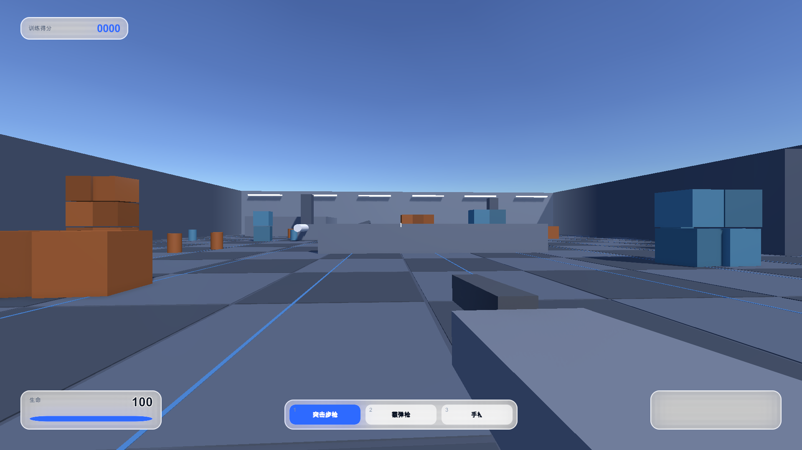
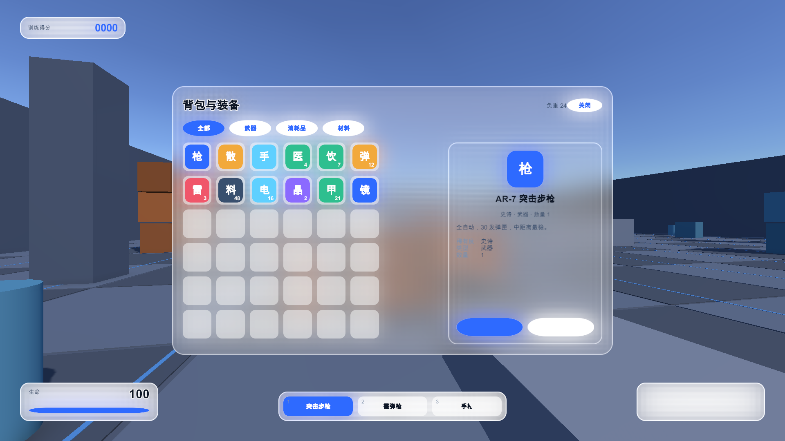
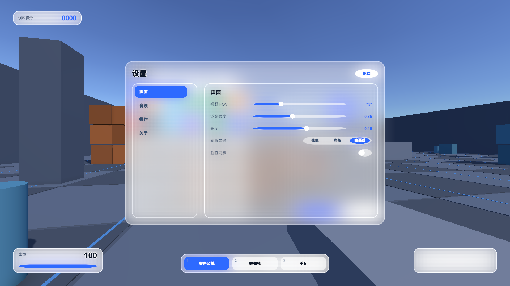
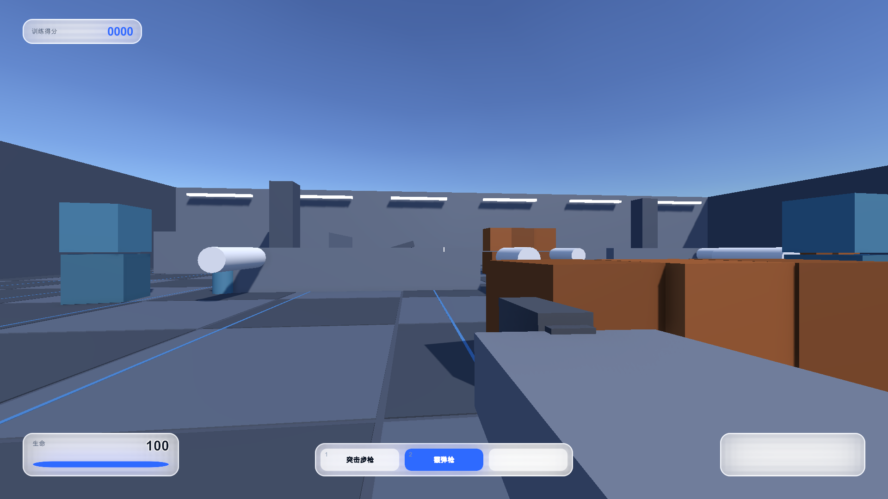
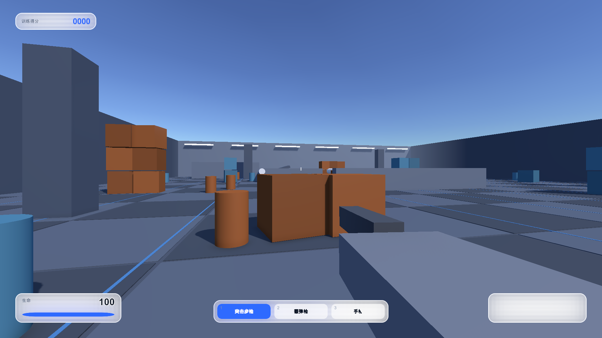

# 毛玻璃游戏 UI（Unity 2022.3 + URP 14）

作品集用的 Demo：一个第一人称训练场，战斗 HUD、背包、设置、切换武器四套 UI 全部长在**实时毛玻璃**上。







## 跑起来

1. Unity Hub 用 **2022.3.62f3c1** 打开本工程。
2. 打开 `Assets/Scenes/Arena.unity`，按 Play。
3. 操作：WASD 移动 · 鼠标看 · 左键射击 · R 换弹 · 1/2/3 或滚轮换武器 · **Tab 背包** · **Esc 设置**。
   打开面板会进慢动作并解锁鼠标，再按一次关掉。

## 毛玻璃是怎么做的

不是贴图，是每帧真实计算：

1. URP 里挂了一个 `FrostedGlassFeature`（ScriptableRendererFeature），在 `AfterRenderingTransparents` 插入一个 Pass：
   **把相机颜色拷出来 → 降采样到 1/4 → 先横后竖做分离式高斯（两次迭代）→ 作为全局纹理 `_FrostedGlassTex` 公布出去。**
2. UI 那边用 `UI/FrostedGlass` 着色器按**屏幕 UV** 采这张图 —— 所以每块面板显示的正好是它身后那块被糊掉的画面，
   1:1 精确裁切，不平铺、不拉伸（这就是"按 uv 精确裁切"的落点）。
3. 圆角、描边、边缘高光来自程序化生成的九宫格遮罩（`GlassSpriteGenerator`，A=形状 / R=边缘渐变 / G=描边带），
   所以控件直接用 `Image`，任意尺寸任意圆角都不用换贴图，后面进度条也能用 `Image.Type.Filled`。
4. 玻璃默认不叠任何色调（`_Tint` 保持白），只有一个 `_Milkiness` 奶白度用来保证文字可读性，以及一个可关的边缘高光。

参数在 `Assets/Settings/URP-*-Renderer.asset` 上（选中那个 Renderer 资产就能看到 Frosted Glass Blur 的降采样/迭代/半径）。

## 四套 UI

| | 内容 |
|---|---|
| 战斗 HUD | 准星（开火张开后非线性收拢）、血量条（追条）、弹药/武器名、击杀得分、命中标记、受击红闪、右上飘字 |
| 背包 | 36 格网格、**拖放交换**、物品详情（带属性行）、页签筛选、使用/装备/丢弃（医疗包真的回血、武器真的换枪） |
| 设置 | 四个页签 + 分段选择/滑条/开关；**参数真的生效**：视野改相机 FOV、泛光改 URP Bloom、亮度改 ColorAdjustments、画质改 QualitySettings、音量改 AudioListener |
| 切换武器 | 底部武器条（可点）、数字键、滚轮；换枪是"压枪 → 抬起"的非线性动画，弹药/换弹状态跟着走 |

其他：三把武器都是程序化拼的（不需要美术），射击有后坐弹簧、枪口焰、命中闪光；哨戒炮会朝你开火，躲掩体后面它就打不中（HUD 的血量因此有真实数据）。

## 目录

```
Assets/
  Scripts/Rendering/FrostedGlassFeature.cs   URP 毛玻璃 Pass（拷贝/降采样/分离高斯/全局纹理）
  Scripts/UI/GlassMaterials.cs               材质缓存（毛玻璃按奶白度分档共用）
  Scripts/UI/GlassUI.cs                      UI 工厂：面板/圆角块/文字/胶囊按钮/布局/缓动反馈
  Scripts/UI/GlassTheme.cs                   蓝白配色 + 非线性缓动函数 + 协程补间
  Scripts/UI/HudView.cs                      战斗 HUD + 武器条 + 飘字 + 进度条
  Scripts/UI/PanelsView.cs                   滑条/开关/分段控件 + 背包 + 设置
  Scripts/UI/GameUi.cs                       UI 总入口：画布、面板开关、按键、慢动作
  Scripts/Game/Gameplay.cs                   游戏数据、靶子、哨戒炮、武器系统、第一人称控制器
  Scripts/Game/ArenaBuilder.cs               程序化训练场（地面/掩体/立柱/灯带/靶子/后处理）
  Shaders/FrostedGlassBlur.shader            模糊（5 抽高斯等效 9 抽）
  Shaders/FrostedGlassUI.shader              毛玻璃面片（按屏幕 UV 采样）
  Shaders/RoundedRect.shader                 实心圆角块（蓝白色条/胶囊/进度条/描边）
  Editor/                                    生成圆角贴图 / 装 Feature / 生成场景 / 离屏截图
```

## 批处理验证（CI 友好）

```bash
UNITY="/Applications/Unity/Hub/Editor/2022.3.62f3c1/Unity.app/Contents/MacOS/Unity"
"$UNITY" -batchmode -nographics -projectPath "$PWD" -quit -logFile /tmp/c.log                       # 编译
"$UNITY" -batchmode -nographics -projectPath "$PWD" -executeMethod GlassUI.EditorTools.GlassSpriteGenerator.Generate -quit   # 生成圆角贴图
"$UNITY" -batchmode -nographics -projectPath "$PWD" -executeMethod GlassUI.EditorTools.GlassDemoTools.InstallFeature -quit  # 装毛玻璃 Feature
"$UNITY" -batchmode -projectPath "$PWD" -executeMethod GlassUI.EditorTools.ArenaSceneBuilder.CaptureAll -quit  # 截 HUD/背包/设置三张图
```
注意：同一个工程不能同时被两个 Unity 实例打开，跑批处理前先关掉界面上的 Unity。

## 踩过的坑（都写进代码注释了）

1. **自定义 Graphic 必须显式声明 `[RequireComponent(typeof(CanvasRenderer))]`** —— uGUI 只在 Image/Text 上声明，少了自己写的 Graphic 加出来没有渲染器，画面空白且不报错。
2. **UGUI 的网格路径里 uv1/uv2 传不到着色器**（uv0 可以）。我一开始想把尺寸/圆角塞进 uv1，试了两版都画不出来，纯色探针能画才定位到；最后改成走材质属性 + 贴图遮罩。
3. **UI 着色器别照抄 `ZTest [unity_GUIZTestMode]`**：用相机渲染到 RenderTexture 截图时它是 `LEqual`，画布平面距离 5、而近处地面不到 5，HUD 会被地面挡住。真实游戏用 Overlay 不受影响，但离屏验证会被误导。本工程固定 `ZTest Always`。
4. **在拉伸的 RectTransform 上改 `anchoredPosition` 会被拉伸/变形**（滑条圆钮、分段高亮都栽过）。用锚点表示比例，位置就天然跟着走。

> 截图说明：上面的图是离屏渲染出来的（`ArenaSceneBuilder.CaptureAll`）。
> 画布平面距离设成 1 米，是为了绕开"用相机渲染到 RT 时 UI 走 LEqual 深度测试被近处地面挡住"的问题。
> 枪模（viewmodel）在右下角，但背光很暗、对比度不够，是下一步要补的美术问题。

## 已知取舍

- **场景是自己搭的 blockout**：官方免费 3D 游戏场景只在 Asset Store（要用账号点下载），官方开源 demo（BoatAttack）是 Unity 2020.3 + 全程 Git LFS，升到 2022.3 风险大且是海岛场景，跟"战斗+换武器"不搭。所以训练场是程序化生成的，授权完全干净；以后想换官方资源包，环境物体直接替换即可（UI 不依赖场景）。
- **没有音频与美术资源**：武器、掩体、图标全部程序化生成（文字图标用单字占位）。
- 视角选第一人称：没有角色模型时第三人称会露怯，第一人称只要一把拼出来的枪，正好给"切换武器"提供三个可换对象。
- **枪模对比度不足**：程序化枪体是深色金属，在训练场的逆光下几乎糊成一块，需要补光或提亮材质。
- **类名必须与文件名一致**（踩过一次狠的）：`WeaponSystem`/`PlayerController`/`GameState`/`Sentry` 原来都塞在 `Gameplay.cs` 里，
  Unity 只序列化「类名 == 文件名」的 MonoBehaviour，其余组件存进场景后**直接丢失**（表现为 missing script：枪没了、玩家动不了）。
  现在每个类一个文件。
